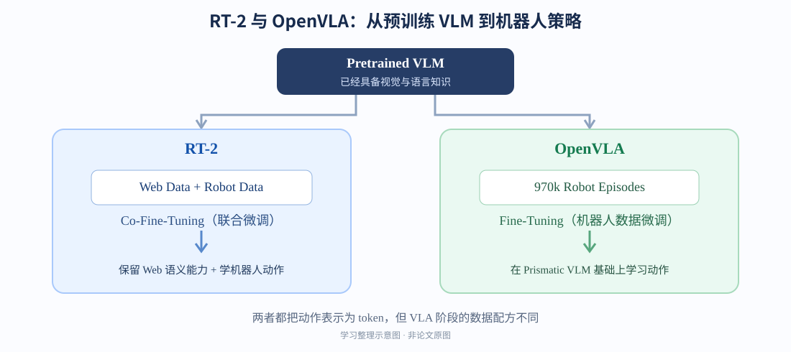

> **Week 2 学习主线：** 从 RT-2 理解 **“把机器人动作当作 token 生成”** 的 VLA 范式，再通过 OpenVLA 理解这一思想如何由 **DINOv2 + SigLIP + MLP Projector + Llama 2** 落地成可微调的开源模型。
>
> **阅读方式：** 先关注研究问题与数据流，再将 Figure 2 对应到 `forward()`、`ActionTokenizer` 和 `predict_action()`；不急着从零复现 7B 模型。

## 0. 本周学习目标与一句话总结

- **RT-2：** 让在互联网图文上预训练的 VLM **直接预测低层机器人动作**；将连续动作离散化为 token，并使用 Web 数据与机器人数据 **co-fine-tuning**。
- **OpenVLA：** 延续动作 token 化思路，用 **Prismatic-7B** 作为底座，在约 **970k** 机器人轨迹上微调，打造可以获取权重与源码、并适配新任务的 VLA。
- **理解边界：** Web 预训练主要帮助模型“理解该操作谁、为什么”，机器人示范主要帮助模型“怎样完成实际运动”；Web 知识 **不能凭空创造训练数据里没有的运动技能**。

| 关键词 | 含义 | 在论文里的角色 |
| --- | --- | --- |
| VLM | Vision-Language Model，视觉语言模型 | 看图 + 理解语言 + 生成文本 |
| VQA | Visual Question Answering，视觉问答 | 一种训练/评估任务，**不是 Transformer 的特殊层** |
| VLA | Vision-Language-Action | 输入视觉与指令，生成机器人动作 |
| Backbone | 骨干网络/基础模型 | RT-2 的 PaLI-X/PaLM-E；OpenVLA 的 Prismatic |
| Baseline | 对比基线 | 如 RT-1、Octo、Diffusion Policy 等比较对象 |
| Pre-training | 预训练 | 先获得通用视觉语言表示与知识 |
| Fine-tuning | 微调 | 基于预训练参数继续用目标数据更新模型 |
| Co-fine-tuning | 联合微调 | **RT-2 中同时混用 Web 与 Robot 数据**继续训练同一个模型 |

---

## 1. RT-2：机器人也可以“说动作语言”

**论文：** [RT-2: Vision-Language-Action Models Transfer Web Knowledge to Robotic Control](https://arxiv.org/abs/2307.15818)（Brohan et al., 2023）  
**建议精读：** Figure 1、§3.1–3.3、§4.2–4.4、§5。


*图 1：RT-2 官方项目页的总体方案示意。来源：[RT-2 项目官网](https://robotics-transformer2.github.io/)；与论文 Figure 1 对应。*

### 1.1 研究动机：VLM 认识世界，机器人却需要动作

以前常见方法把语言模型用于**高层规划**，再调用独立的低层控制器完成 `pick` / `place`。问题在于：大规模图文预训练获得的语义能力，未必真正进入执行动作的策略。

RT-2 直接将问题改写为：

```text title="rt2-core-flow.txt"
Robot image + Task instruction
              ↓
   Pretrained VLM (PaLI-X / PaLM-E)
              ↓
      Action token sequence
              ↓
        De-tokenization
              ↓
       Robot low-level action
              ↓
       New observation → ...
```

**关键区别：** RT-2 的 VLM **本身成为 policy**，而不仅仅是给另一个控制器提供口头计划。

### 1.2 核心创新：Action Tokenization

RT-2 每一步输出的动作包含末端执行器 **6-DoF 位移/旋转变化**、夹爪开合，以及终止指令。可以抽象成：

\[
 a_t=(\mathrm{terminate},\Delta x,\Delta y,\Delta z,
 \Delta r_x,\Delta r_y,\Delta r_z,\mathrm{gripper})
\]

其中连续维度分别均匀离散为 **256 个 bin**；每个 bin 与语言模型词表中的一个 token 对应。终止指令是单独的离散量。因此，机器人动作变成类似语言生成的 token 序列。**“128”不是移动 128 米，而是对应某个离散动作区间。**


*图 2：RT-2 官方项目页的动作编码示意，包含 termination、平移、旋转和 gripper；注意这是项目页配图，并非论文中编号为 Figure 3 的泛化实验图。*

这样，原本不同的两个任务被统一：

```text title="unified-output.txt"
VQA:   Image + Question     → Language tokens
Robot: Image + Instruction  → Action tokens

统一成：Multimodal input → Token sequence prediction
```

**为什么不直接预测连续数值？** 当然可以另外设计回归头，但 tokenization 使 RT-2 可以复用 VLM 的输出词表、序列生成目标和绝大部分模型参数，而不必专门引入一个动作输出网络。

> **思考结论：** Action Tokenization 的创新不只在“256 个 bin”，更在于把 **Language Generation 与 Action Generation 统一为序列生成问题**。

### 1.3 为什么要 Co-Fine-Tuning？

- **只用 Robot Data fine-tune：** 学习动作，但存在削弱原有互联网语义知识的风险。
- **RT-2 Co-Fine-Tuning：** 训练 batch 中同时采样 **原有 Web 视觉语言数据 + Robot 示范数据**，并上调 Robot 数据采样权重。
- **目标：** 学运动，同时保持数字、符号、物体关系、语言和基础推理等预训练知识。


*图 3：RT-2 官方项目页的消融结果；Co-Fine-Tuned 通常比 Fine-Tuned 和 Scratch 有更好的泛化。对应论文 §4.3 的训练策略与模型规模实验。*

### 1.4 从 Web 迁移了什么？没有迁移什么？

举例：指令是“我需要一件可以临时敲钉子的物体”。模型利用常识推理“石头可以用来敲击”，然后调用在机器人数据中学到的 `pick` 技能去拿石头。

| 来源 | 主要贡献 | 不能直接推导为 |
| --- | --- | --- |
| Web 数据 | 物体类别、符号、颜色、关系、常识、语义推理 | 自动习得新的机械臂运动轨迹 |
| Robot 数据 | 从观察与指令到实际动作的映射 | 拥有互联网全部开放词汇知识 |

论文 §4.4 还探索了 **Plan → Action**：先生成自然语言 Plan，再输出动作 token。这是将简单语义推理与低层动作生成放在一个模型中的早期尝试。**注意：语言计划不是执行运动技能本身。**

### 1.5 RT-2 的局限

1. 物理技能仍受机器人示范数据的动作/技能分布限制。
2. 55B 大模型计算开销较高；论文使用云端 TPU 推理，报告约 **1–3 Hz**。
3. 离散动作和自回归生成易受到控制频率、精度与时延的约束。

---

## 2. OpenVLA：从 VLA 思想到开源可训练模型

**论文：** [OpenVLA: An Open-Source Vision-Language-Action Model](https://arxiv.org/abs/2406.09246)（Kim et al., 2024）  
**官方仓库：** [openvla/openvla](https://github.com/openvla/openvla)  
**建议精读：** Figure 2、§3.1–3.5、§5.2–5.4。


*图 4：OpenVLA Figure 2，图片来源：[OpenVLA 项目官网](https://openvla.github.io/)；重点观察图像与语言两条输入路径如何合成同一个序列。*

### 2.1 训练顺序与 RT-2 的区别

OpenVLA 不是先“经过 Robot Data”，而是 **Pretrained VLM + Robot Data → Fine-Tuning**。Robot Data 是训练材料，并不是神经网络中的一层。



- **RT-2：** 预训练 VLM + Web Data + Robot Data → **Co-Fine-Tuning**。
- **OpenVLA：** 预训练 **Prismatic-7B** + 约 **970k** Robot Episodes → **Robot-only Fine-Tuning**（VLA 阶段不继续混合原始 Web 训练数据）。

这也帮助解释论文 §5.1 的一个现象：RT-2-X 在某些**困难语义泛化**评测中更强，而 OpenVLA 在不少其他操控任务中表现良好；不能简单解释成“一个模型全方位胜过另一个”。

### 2.2 Prismatic-7B 的三个组成部分

```text title="openvla-forward.txt"
Robot RGB image
  ├─ DINOv2 ── spatial / local representation ─┐
  └─ SigLIP ── semantic / language alignment ──┤
                                               ↓
                                      Concatenate features
                                               ↓
                                        MLP Projector
                                               ↓
                                         Visual embeddings ─┐
                                                            ├─→ Llama 2 7B
Language instruction → Llama tokenizer → Text embeddings ─┘        ↓
                                                           Action token IDs
                                                                  ↓
                                                      De-tokenize + Unnormalize
                                                                  ↓
                                                               7D Action
```

#### DINOv2 与 SigLIP

- **DINOv2：** 视觉自监督预训练得到的特征，有助于保留局部结构、形状和空间信息。
- **SigLIP：** 图文对齐预训练得到的视觉特征，善于与物体名称、属性、语义等语言概念关联。
- **注意：** 两者都具备空间与语义能力；“DINOv2 管位置 / SigLIP 管物体名称”只是**帮助记忆的简化**，不是严格职责划分。

输入不是“整张图片变成一个标签”，而是经过 ViT 得到多个 **patch embeddings**：

\[
X_{\rm dino}\in\mathbb{R}^{B\times N\times D_1},\quad
X_{\rm siglip}\in\mathbb{R}^{B\times N\times D_2}.
\]

两边的 patch 对齐后做特征维度拼接：

\[
X_{\rm fused}=\operatorname{Concat}(X_{\rm dino},X_{\rm siglip},\mathrm{dim}=-1)
\in\mathbb{R}^{B\times N\times(D_1+D_2)}.
\]

`B` 是 batch 大小，`N` 是 patch 数量，`D` 是每个 patch 向量的宽度。**拼接增加的是特征维度，不是 patch 数量**。

#### MLP Projector 为什么必要？

视觉编码器输出维度与 Llama token embedding 的维度、特征表示不同，因此使用可学习映射：

\[
\mathrm{MLP}: \mathbb{R}^{D_{\rm vision}}
\longrightarrow \mathbb{R}^{D_{\rm Llama}}.
\]

通常是 `Linear → GELU → Linear`。它不仅“改维度”，也学习视觉表示到 LLM 输入空间的非线性对齐。**每个 patch 独立经过同一个 MLP，默认不会直接与其他 patch 交换信息**；跨 token 的信息交互主要发生在后续 Transformer 中。

补充：`1×1 Conv` 同样可以把 CNN 特征图从 `C_in` 映射到 `C_out`，在每个空间位置做通道线性变换；但 OpenVLA 的视觉表示自然采用 `[B, N, D]` 的 token 序列，因此 `Linear/MLP` 更直接。

#### Llama 为什么能输出 Robot Action？

经 Projector 后，视觉 embedding 的最后一维与文本 embedding 对齐。模型把视觉 embeddings **插入**文本 embedding 序列，交给 Llama：

```text title="multimodal-input.txt"
[BOS] [IMG_1] [IMG_2] ... [IMG_N] [Text_1] ... [Text_T]
                          ↓
                  Llama Transformer
                          ↓
             token-by-token action generation
```

Llama 本身不会直接处理 JPEG 像素；看到的是图像编码器处理并投影后的**连续向量**。Action Tokenizer 将机器人动作区间对应到语言模型 token ID，故语言模型原有的 **next-token prediction** 机制仍然可以用于动作预测。

### 2.3 Action Tokenization：与 RT-2 相同的范式，不同的细节

OpenVLA 对 7D 连续动作的每个维度做离散化，映射到 **256 个动作 token**。与 RT-2 的差别之一是：OpenVLA 为减少异常值影响，利用训练数据的 **1% / 99% 分位数**确定归一化尺度。

```text title="openvla-action-encoding.txt"
Raw robot action
      ↓  q01 / q99 normalization
Normalized action (roughly [-1, 1])
      ↓  256-bin discretization
Discrete index
      ↓  map to Llama vocabulary
Action token IDs
```

这也解释了为什么源码中的 `ActionTokenizer` 默认使用 `[-1, 1]`：**分位数归一化在更早的数据处理阶段进行**，两处并不矛盾。分位数之外的极端值按流程裁剪。

预测阶段反过来：

\[
a=\frac{\hat a+1}{2}(q_{99}-q_{01})+q_{01},
\]

其中 \(\hat a\) 是恢复后的归一化动作；实际实现会根据掩码决定哪些维度需要做该变换。

### 2.4 数据、Loss、Fine-tuning

- **数据：** 由 Open X-Embodiment 筛选、整理出约 **970k** 条轨迹，强调机器人形态、环境和任务多样性。
- **输入格式：** `Image + “What action should the robot take to {instruction}?”`。
- **训练监督：** 生成式 **cross-entropy**，主要在 **action tokens** 对应位置计算 loss，Prompt 的 labels 置为 `-100`（PyTorch 的 `ignore_index`）。是否包含结束 token 与实现配置有关。
- **训练策略：** OpenVLA 主训练并非 RT-2 式 Web+Robot Co-Fine-Tuning；论文发现 VLA 训练时**微调视觉编码器**很重要。
- **高效微调：** §5.3 的实验中，LoRA 使用约 **1.4%** 的可训练参数获得接近 full fine-tuning 的性能；注意这组消融使用了论文脚注所说明的较简化模型变体，不应无条件套用于所有配置。


*图 5：OpenVLA 的参数高效微调比较，来源：[OpenVLA 官网](https://openvla.github.io/)，对应论文 §5.3 Table 1。*

### 2.5 实验结论：OpenVLA 的强项与边界


*图 6：OpenVLA 官网 BridgeData V2 多项泛化任务结果，对应论文 §5.1；不能只看平均成功率，还要注意 Semantic Generalization 等细分项。*

我目前的理解：OpenVLA 的关键价值不仅是“比谁分数更高”，还在于**开源底座 + 大规模跨机器人数据 + 可适配新场景 + 可研究训练与推理细节**。同时，原始 OpenVLA 主要使用单图像、单步动作生成，对于高频精细控制有局限；在部分狭窄、精细操作任务中，Diffusion Policy 仍可能表现更好。

---

## 3. 论文与源码如何一一对应？

> 以下路径基于 [OpenVLA 官方仓库](https://github.com/openvla/openvla) 的 `main` 代码结构。仓库可能更新，精读或复现时建议固定 commit 并记录版本；不同分支或 HuggingFace 包装接口可能不同。

| 论文位置 | 代码文件 / 函数 | 阅读时应该追问 |
| --- | --- | --- |
| OpenVLA Figure 2 / §3.1 | [`prismatic/models/backbones/vision/dinosiglip_vit.py`](https://github.com/openvla/openvla/blob/main/prismatic/models/backbones/vision/dinosiglip_vit.py) · `DinoSigLIPViTBackbone.forward()` | 为什么使用两套预处理？为什么 `torch.cat(..., dim=2)`？ |
| §3.1 | [`prismatic/models/vlms/prismatic.py`](https://github.com/openvla/openvla/blob/main/prismatic/models/vlms/prismatic.py) · `PrismaticVLM.forward()` | Visual embeddings 插入到 Text embeddings 的哪个位置？`attention_mask` 怎样对应？ |
| §3.2 | [`prismatic/vla/action_tokenizer.py`](https://github.com/openvla/openvla/blob/main/prismatic/vla/action_tokenizer.py) · `ActionTokenizer` | 如何分 bin、映射词表末尾 token、反向解码？ |
| §3.2/3.3 | [`prismatic/vla/datasets/datasets.py`](https://github.com/openvla/openvla/blob/main/prismatic/vla/datasets/datasets.py) · `RLDSBatchTransform` | 图像 / 指令 / 动作怎么组成训练样本？哪些 labels 被 mask？ |
| §3.2/3.5 | [`prismatic/models/vlas/openvla.py`](https://github.com/openvla/openvla/blob/main/prismatic/models/vlas/openvla.py) · `predict_action()` | token IDs 如何变成归一化动作、再反归一化？ |
| §3.3 | [`prismatic/vla/datasets/rlds/oxe/mixtures.py`](https://github.com/openvla/openvla/blob/main/prismatic/vla/datasets/rlds/oxe/mixtures.py) | 各数据集的混合权重如何定义？ |
| §3.4/3.5 | [`vla-scripts/train.py`](https://github.com/openvla/openvla/blob/main/vla-scripts/train.py) | `Dataset → Batch → Loss → Backward` 如何连接？ |
| §5.3 | [`vla-scripts/finetune.py`](https://github.com/openvla/openvla/blob/main/vla-scripts/finetune.py) | 哪些模块参与 LoRA？训练参数占比是多少？ |

### 3.1 最值得理解的三小段代码

**① 双视觉分支融合：**

```python title="dinosiglip_vit.py · 核心逻辑摘录/简化"
dino_patches = self.dino_featurizer(pixel_values["dino"])
siglip_patches = self.siglip_featurizer(pixel_values["siglip"])
fused = torch.cat([dino_patches, siglip_patches], dim=2)
```

**② 融合视觉与文本 embeddings：**

```python title="prismatic.py · 核心逻辑摘录/简化"
patch_features = self.vision_backbone(pixel_values)
visual_embeds = self.projector(patch_features)
text_embeds = self.llm_backbone.embed_input_ids(input_ids)

multimodal_embeds = torch.cat(
    [text_embeds[:, :1, :], visual_embeds, text_embeds[:, 1:, :]],
    dim=1,
)
```

**③ 只对需要学习的位置计算 loss（示意）：**

```python title="datasets.py · 思想示意，不是完整源码"
labels = input_ids.clone()
labels[prompt_positions] = -100  # ignore prompt in cross entropy
# action-token positions remain supervised
```

> 这三个片段构成一个完整闭环：**视觉信息怎样进入 Llama、动作怎样成为 token、模型怎样通过监督学习动作**。

### 3.2 Tensor Shape 练习

以下数字只是用于理解，不保证等于实际 checkpoint 的每一层配置：

```text title="tensor-shapes.txt"
DINOv2 : [B, 256, 1024]
SigLIP : [B, 256, 1152]
Concat : [B, 256, 2176]
MLP    : [B, 256, 4096]
Text   : [B,  20, 4096]
Fusion : [B, 276, 4096]  # 沿 sequence 维度拼接
```

> 关键判断：`dim=2` 的 concat 增加 **feature dimension**；`dim=1` 的 concat 增加 **sequence length**。MLP 不会自动让 patch 1 获得 patch 200 的信息，跨 token 信息交互主要由 Transformer 的 Attention 完成。

---

## 4. RT-2 与 OpenVLA 对照

| 维度 | RT-2 | OpenVLA |
| --- | --- | --- |
| 核心定位 | 将 Web 知识迁移到闭环机器人控制 | 构建开源、可微调、跨机器人的通用 VLA |
| 基础模型 | PaLI-X / PaLM-E | Prismatic-7B（DINOv2 + SigLIP + Llama 2） |
| 动作表达 | 动作离散化为 token | 同样离散化为 token，强调 q01/q99 范围 |
| VLA 阶段训练 | Web + Robot **co-fine-tuning** | 约 970k robot episodes **fine-tuning** |
| 知识迁移侧重点 | 新物体、新符号和语义推理 | 强调多机器人、泛化以及后续微调可用性 |
| 开放程度 | 核心大规模模型未完整开放供复现 | 发布权重、训练/微调代码与数据配置 |
| 推理约束 | 大模型云端推理、控制频率受限 | 较小的 7B，但仍有显存与频率成本 |

**我的阶段性总结：** RT-2 回答 **“VLM 能不能直接变成机器人 policy？”**；OpenVLA 更强调 **“怎样把这套范式做成可下载、可理解、可微调的机器人基础模型？”**

---

## 5. 阅读过程中真正搞懂的问题（Q&A）

**Q1. VQA 是不是 Transformer 里的一个特殊序列？**  
不是。VQA 指 **Visual Question Answering（视觉问答）**，是视觉语言模型的一类任务；Transformer 只是把问题文本表示为 token，在多模态输入条件下生成答案。

**Q2. Backbone 和 Baseline 是同一个概念吗？**  
不是。Backbone 是模型的骨干/基础结构；Baseline 是实验对比参照。OpenVLA 的 backbone 是 Prismatic，RT-1/Octo 等可以作为比较方法。

**Q3. 为什么要先 Pretrained VLM，再加 Robot Data 微调？**  
为了复用互联网预训练获得的视觉语言知识，避免仅凭数量相对有限的机器人示范从零学习“物体是什么、指令是什么意思”等基础知识。表达式应写为 **Pretrained VLM + Robot Data → Fine-Tuning**。

**Q4. 为什么 Action Tokenization 而不是直接回归连续动作？**  
为了复用语言模型现成的词表、输出层和自回归训练范式；不是说连续动作回归不可行。离散化也会引入精度损失。

**Q5. Co-fine-tuning 为什么重要？**  
因为在学习 Robot Action 时持续保留 Web 数据训练信号，有利于减少原有语义知识退化并改善泛化。它是**同一个模型联合使用多种数据**，不是两个模型一起微调。

**Q6. MLP Projector 是什么？能否用 1×1 Conv？**  
MLP Projector 是多层感知机，进行维度变化和可学习非线性表示映射。1×1 Conv 同样可以改变通道数；在 `[B,N,D]` 形式的 token 数据上，Linear/MLP 更自然。

**Q7. Fine-tuning 和 Inference 的目标有何不同？**  
训练阶段用示范动作构造 `labels` 并更新模型参数；推理阶段使用 `generate()` 逐 token 预测，再将动作 token 转回物理动作，**不执行参数更新**。

---

## 参考资料与图片来源

1. Brohan et al. (2023), **RT-2: Vision-Language-Action Models Transfer Web Knowledge to Robotic Control**：[论文](https://arxiv.org/abs/2307.15818) / [项目页](https://robotics-transformer2.github.io/)。图 1–3 为 RT-2 项目页配图，著作权归原作者。
2. Kim et al. (2024), **OpenVLA: An Open-Source Vision-Language-Action Model**：[论文](https://arxiv.org/abs/2406.09246) / [项目页](https://openvla.github.io/) / [官方 GitHub](https://github.com/openvla/openvla)。图 4–6 为 OpenVLA 项目页/论文配图，著作权归原作者。
3. 文中 `training-recipes.svg` 为基于两篇论文内容绘制的**学习示意图，并非原论文图片**。
4. **图片加载说明：** 论文原图采用官方项目站点的 HTTPS 地址，打开页面时需能访问对应网站。为了离线使用，可以按原图 URL 另存到本地 `assets/`，再将 Markdown 图片路径替换为本地路径。
